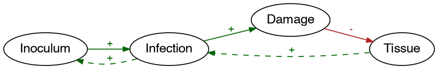
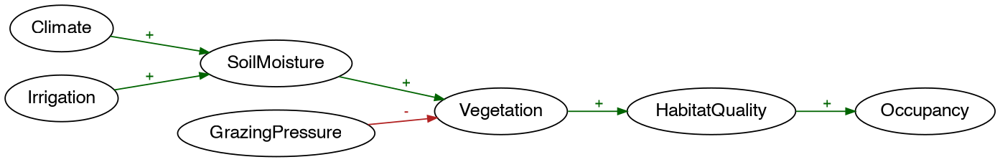
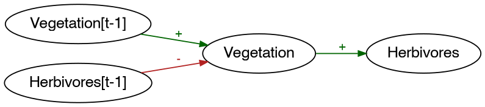
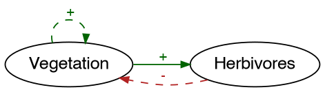

# Causal loop diagrams, and what a Bayesian network does to one
Simon Frost

- [Overview](#overview)
- [Four polarities, and why not
  three](#four-polarities-and-why-not-three)
- [A sketch, and its loops](#a-sketch-and-its-loops)
- [Reading a sign off a table](#reading-a-sign-off-a-table)
  - [Why this is a labelling and not a
    convention](#why-this-is-a-labelling-and-not-a-convention)
- [Two readings of one network](#two-readings-of-one-network)
- [Where the loops come back](#where-the-loops-come-back)
  - [The two kinds of loop](#the-two-kinds-of-loop)
- [Holding a sketch against a model](#holding-a-sketch-against-a-model)
- [Coarsening, and the arithmetic it
  needs](#coarsening-and-the-arithmetic-it-needs)
- [What a polarity cannot carry](#what-a-polarity-cannot-carry)
- [References](#references)

## Overview

A causal loop diagram is the first thing drawn when a group of people
describe a system: factors joined by arrows, a sign on each arrow, loops
closing back on themselves. Baez formalises one as a graph whose edges
are labelled by elements of a monoid of *polarities*, which makes a
labelling the same thing as a functor from the free category on the
graph into the delooping of that monoid ([Baez 2024](#ref-Baez2024));
with Chaudhuri he goes on to three kinds of morphism between labelled
graphs – refining, simplifying, finding motifs – and to a homology that
counts the feedback a composite acquires that neither part had ([Baez
and Chaudhuri 2025](#ref-BaezChaudhuri2025)).

A Bayesian network carries much more than a sign per arrow, and one
thing less: it must be acyclic, so it cannot hold a loop at all. This
vignette walks the translation in both directions and is as interested
in what it loses as in what it keeps.

``` julia
using CausalLoopDiagrams
using BayesianNetworks

# The figures go in `<vignette>_figures/`, which `scripts/sync_vignettes.jl` carries into
# `docs/src/tutorials/` alongside the Markdown, so the same relative paths work in the
# vignette tree and in the manual. Not `<vignette>_files/`: quarto owns that name and
# expects only its own subdirectories in it.
const FIGURES = "01_causal_loop_diagrams_figures"
mkpath(FIGURES)

function draw(x, file; dpi = 130, kw...)
    graph = to_graphviz(x; graph_attrs = Dict(:dpi => string(dpi)), kw...)
    open(joinpath(FIGURES, file), "w") do io
        Graphviz.run_graphviz(io, graph; format = "png")
    end
    return nothing
end
nothing # hide
```

## Four polarities, and why not three

The basic case is the sign group, `{+, -}`. Adding an element for
“indeterminate” gives Baez’s three-element monoid `{+, 0, -}`. This
package uses four, because a conditional probability table distinguishes
two things that monoid writes alike:

``` julia
polarities()
```

    (0, +, -, ?)

`NO_EFFECT` is the link along which nothing moves – a table that does
not depend on that parent at all – and `INDETERMINATE` is a link whose
direction the diagram does not determine. On a whiteboard the two are
indistinguishable; in a table they are different facts, and the first is
a finding rather than an absence of one.

The four values are the subsets `{0}`, `{+}`, `{-}` and `{0, +, -}` of
the sign hyperfield, and those four subsets are closed under its
multiplication and its (multivalued) addition. So they form a
commutative rig: a sub-rig of the power-set rig Baez builds from the
sign hyperfield. Multiplication composes links along a path and addition
combines links in parallel.

``` julia
println("composition along a path:")
for a in polarities()
    println("  ", [a * b for b in polarities()])
end
println("links in parallel:")
for a in polarities()
    println("  ", [a + b for b in polarities()])
end
println("units: one = ", one(Polarity), ", zero = ", zero(Polarity))
```

    composition along a path:
      Polarity[0, 0, 0, 0]
      Polarity[0, +, -, ?]
      Polarity[0, -, +, ?]
      Polarity[0, ?, ?, ?]
    links in parallel:
      Polarity[0, +, -, ?]
      Polarity[+, +, ?, ?]
      Polarity[-, ?, -, ?]
      Polarity[?, ?, ?, ?]
    units: one = +, zero = 0

Two things to read off those tables. `NO_EFFECT` is absorbing for
composition – a path through a dead link is dead – and the unit for
addition. And a positive link beside a negative one adds to `?`: two
pathways that disagree, with nothing in the formalism to say which wins.
That is not a gap in the implementation, it is what a sign is.

## A sketch, and its loops

Here is a seasonal tree disease as a practitioner would sketch it.
Inoculum meets host tissue and infection follows; infection replenishes
the inoculum for next season and damages the host; and a damaged host
carries less tissue to infect. `delayed` marks the links that do not act
within the period.

``` julia
sketch = causal_loop_diagram([(:Inoculum, :Infection) => POSITIVE,
                              (:Infection, :Damage) => POSITIVE,
                              (:Damage, :Tissue) => NEGATIVE,
                              delayed((:Tissue, :Infection) => POSITIVE),
                              delayed((:Infection, :Inoculum) => POSITIVE)])
draw(sketch, "sketch.png")
sketch
```

<div class="c-set">
<span class="c-set-summary">CausalLoopDiagrams.CausalLoopDiagram {Factor:4, Link:5, Label:0, Sign:0, Flag:0}</span>

| Factor | factor_name |
|-------:|------------:|
|      1 |    Inoculum |
|      2 |   Infection |
|      3 |      Damage |
|      4 |      Tissue |

| Link | link_source | link_target | link_polarity | link_delay |
|-----:|------------:|------------:|--------------:|-----------:|
|    1 |           1 |           2 |            \+ |      false |
|    2 |           2 |           3 |            \+ |      false |
|    3 |           3 |           4 |            \- |      false |
|    4 |           4 |           2 |            \+ |       true |
|    5 |           2 |           1 |            \+ |       true |

</div>

<div id="fig-sketch">



Figure 1: A seasonal disease as a causal loop diagram. Green is
positive, red negative; a dashed link crosses a delay.

</div>

``` julia
foreach(println, loops(sketch))
loop_summary(sketch)
```

    Inoculum -> Infection -> Inoculum (+, reinforcing, delayed)
    Infection -> Damage -> Tissue -> Infection (-, balancing, delayed)

    (loops = 2, reinforcing = 1, balancing = 1, undetermined = 0, inactive = 0, delayed = 2, instantaneous = 0)

Two loops that pull against each other. The inoculum loop is
reinforcing: a heavy season leaves a heavy inoculum. The damage loop is
balancing: an epidemic that defoliates its host removes what it needs. A
loop’s polarity is the product of the signs around it, and because the
rig is commutative it does not depend on where the loop is cut –

``` julia
(loop_polarity(sketch, [:Infection, :Damage, :Tissue]),
 loop_polarity(sketch, [:Tissue, :Infection, :Damage]))
```

    (-, -)

– which is what makes it a property of the loop rather than of how it
was written down.

## Reading a sign off a table

Nothing so far has needed probabilities. The bridge to the networks is
`polarity`, which reads a sign off a conditional probability table by
**stochastic monotonicity** in the declared order of the states: the
child’s distribution rises with the parent if its upper tail never
shrinks, for every configuration of the other parents.

``` julia
rain = FiniteAxis(:Rain, [:dry, :wet])
grass = FiniteAxis(:Grass, [:brown, :green])

(polarity(cpt(rain, grass, [0.9 0.1; 0.2 0.8]), :Rain),
 polarity(cpt(rain, grass, [0.1 0.9; 0.8 0.2]), :Rain),
 polarity(cpt(rain, grass, [0.5 0.5; 0.5 0.5]), :Rain))
```

    (+, -, 0)

Dominance is a stronger requirement than a rising mean, and deliberately
so. The table below has damage increasing in load on average, but the
middle row does not dominate the first – less chance of `none` *and*
less chance of `severe` – so there is no one direction to report:

``` julia
load = FiniteAxis(:Load, [:low, :medium, :high])
damage = FiniteAxis(:Damage, [:none, :some, :severe])
spread = cpt(load, damage, [0.6 0.1 0.3; 0.2 0.7 0.1; 0.1 0.2 0.7])
polarity(spread, :Load)
```

    ?

An interaction between two parents comes out the same way, which is the
honest answer: the sign of one link depends on the state of another
factor, and a label on an edge has nowhere to put that.

``` julia
allele = FiniteAxis(:Allele, [:absent, :present])
exposure = FiniteAxis(:Exposure, [:low, :high])
harm = FiniteAxis(:Harm, [:no, :yes])
table = Array{Float64}(undef, 2, 2, 2)
table[1, 1, :] = [0.8, 0.2]      # no allele, low exposure
table[1, 2, :] = [0.4, 0.6]      # no allele, high exposure: worse
table[2, 1, :] = [0.9, 0.1]      # allele, low exposure
table[2, 2, :] = [0.95, 0.05]    # allele, high exposure: better
interacting = cpt([allele, exposure], harm, table)

(polarity(interacting, :Exposure), polarity(interacting, :Allele))
```

    (?, -)

### Why this is a labelling and not a convention

Monotone kernels compose. If the child’s distribution rises with the
parent and a further kernel is monotone in the child, then the composite
rises with the parent – so the polarity of a path really is the product
of the polarities of its links, which is exactly what Baez’s lemma
requires of a labelling. It is worth checking rather than asserting:

``` julia
sheep = FiniteAxis(:Sheep, [:few, :many])
first_links = [cpt(rain, grass, [0.9 0.1; 0.2 0.8]), cpt(rain, grass, [0.1 0.9; 0.8 0.2])]
second_links = [cpt(grass, sheep, [0.7 0.3; 0.25 0.75]),
                cpt(grass, sheep, [0.3 0.7; 0.75 0.25])]

for f in first_links, g in second_links
    composite = polarity(compose_kernel(f, g), :Rain)
    product = polarity(f, :Rain) * polarity(g, :Grass)
    println(polarity(f, :Rain), " then ", polarity(g, :Grass), " gives ", composite,
            "; the product is ", product, "  (",
            composite === product ? "agree" : "DISAGREE", ")")
end
```

    + then + gives +; the product is +  (agree)
    + then - gives -; the product is -  (agree)
    - then + gives -; the product is -  (agree)
    - then - gives +; the product is +  (agree)

## Two readings of one network

A causal loop diagram’s arrow claims causation, but diagrams get drawn
in workshops from things that were seen to move together. Those are
different questions, and `causal_loop_diagram` will answer either one
about a model whose tables are bound.

The reference habitat network is a tree with no confounding in it, and
the two readings agree on every link:

``` julia
habitat = reference_habitat_model()
structural = causal_loop_diagram(habitat)
observational = causal_loop_diagram(habitat; mode = :observational)
draw(structural, "habitat.png")
compare_diagrams(structural, observational)
```

    DiagramComparison: 6 agree, 0 disagree, 0 only in the first, 0 only in the second

<div id="fig-habitat">



Figure 2: The reference habitat network read as a causal loop diagram.
It is acyclic, as every Bayesian network must be, so it has no feedback
in it.

</div>

Now a model with confounding. Fertiliser goes on poor soil; soil drives
yield harder than fertiliser does. Both mechanisms are monotone, so
neither link is indeterminate:

``` julia
bn = bayesnet(:Soil => [:poor, :rich], :Fertiliser => [:none, :some],
              :Yield => [:low, :high];
              mechanisms = [:Fertiliser => :Soil, :Yield => (:Soil, :Fertiliser)])
yield = Array{Float64}(undef, 2, 2, 2)
yield[1, 1, :] = [0.9, 0.1]      # poor soil, no fertiliser
yield[1, 2, :] = [0.7, 0.3]      # poor soil, fertiliser
yield[2, 1, :] = [0.3, 0.7]      # rich soil, no fertiliser
yield[2, 2, :] = [0.1, 0.9]      # rich soil, fertiliser
farm = bind_cpt(BayesModel(bn),
                [:Soil => [0.5, 0.5], :Fertiliser => [0.1 0.9; 0.9 0.1],
                 :Yield => yield])

compare_diagrams(causal_loop_diagram(farm),
                 causal_loop_diagram(farm; mode = :observational))
```

    DiagramComparison: 2 agree, 1 disagree, 0 only in the first, 0 only in the second
      Fertiliser -> Yield: + against -

Applying fertiliser raises the yield and observing it lowers the
expectation, because fertiliser marks poor soil. A diagram drawn from
co-movement has that link signed backwards while claiming to be causal,
and the disagreement list is the check – computed, not argued.

## Where the loops come back

The sketch had two loops; the networks above have none, because that is
what acyclicity means. The loops are not lost, though: in a dynamic
network they are carried by the lags. A transition template is an
ordinary acyclic network over variables named `X` and `X[t-1]`, and
quotienting the time index puts the feedback back.

``` julia
grazing = vegetation_herbivore_model()
template = causal_loop_diagram(transition_network(grazing))
draw(template, "template.png")
(nfactors = nfactors(template), loops = length(loops(template)))
```

    (nfactors = 4, loops = 0)

<div id="fig-template">



Figure 3: The transition template as a causal loop diagram, with the
lagged variables still separate factors. Acyclic, so no loops.

</div>

``` julia
collapsed = causal_loop_diagram(grazing)
draw(collapsed, "collapsed.png")
foreach(println, loops(collapsed))
loop_summary(collapsed)
```

    Vegetation -> Vegetation (+, reinforcing, delayed)
    Vegetation -> Herbivores -> Vegetation (-, balancing, delayed)

    (loops = 2, reinforcing = 1, balancing = 1, undetermined = 0, inactive = 0, delayed = 2, instantaneous = 0)

<div id="fig-collapsed">



Figure 4: The same template with the time index collapsed. The loops are
back, and the links that crossed a slice boundary are the dashed ones.

</div>

Grazing comes out balancing – more vegetation, more herbivores, less
vegetation next season – and the sign was computed from the conditional
probability tables rather than asserted. Vegetation persisting from one
slice to the next comes back as a self-link, which is the shortest
feedback loop there is.

### The two kinds of loop

That distinction is the one that decides what can be modelled, and it is
why a link carries a delay flag at all.

``` julia
mixed = causal_loop_diagram([(:Price, :Supply) => POSITIVE,
                             (:Supply, :Price) => NEGATIVE,
                             (:Stock, :Harvest) => POSITIVE,
                             delayed((:Harvest, :Stock) => NEGATIVE)])
println("delayed:       ", delayed_loops(mixed))
println("instantaneous: ", instantaneous_loops(mixed))
```

    delayed:       Loop[Stock -> Harvest -> Stock (-, balancing, delayed)]
    instantaneous: Loop[Price -> Supply -> Price (-, balancing, instantaneous)]

A delayed loop is one a dynamic Bayesian network holds as it stands. An
instantaneous loop asserts that everything in it happens at once; no
Bayesian network holds one, and unrolling does not help, because there
is no slice boundary for the closing link to cross. Representing one
means changing the model – splitting the factor into stages, or
admitting a delay the sketch left out.

## Holding a sketch against a model

The last use is the one that keeps a modelling exercise honest. Put the
sketch beside the diagram read off the finished network, and the
differences are a list of what the modelling did.

``` julia
one_season = causal_loop_diagram([(:Inoculum, :Infection) => POSITIVE,
                                  (:Infection, :Damage) => POSITIVE,
                                  (:Damage, :Tissue) => POSITIVE,
                                  (:Weather, :Infection) => POSITIVE])
compare_diagrams(sketch, one_season)
```

    DiagramComparison: 2 agree, 1 disagree, 2 only in the first, 1 only in the second
      Damage -> Tissue: - against +
      Tissue -(+)-> Infection: only in the first
      Infection -(+)-> Inoculum: only in the first
      Weather -(+)-> Infection: only in the second

Three kinds of entry, and each is worth a question. A link only in the
sketch is feedback the network cut. A link only in the network is
something the sketch had not thought of. A link both have with different
signs is a disagreement that one of the two has got wrong.

## Coarsening, and the arithmetic it needs

Baez’s simplifying morphism is the push-forward of edge labels along a
map of graphs, and it is the operation that forces the labels to be
addable: when two factors merge, the links between them and a third
become parallel and have to be combined.

``` julia
pathways = causal_loop_diagram([(:Shade, :Growth) => NEGATIVE,
                                (:Shelter, :Growth) => POSITIVE])
canopy = coarsen(pathways, Dict(:Shade => :Canopy, :Shelter => :Canopy))
canopy
```

<div class="c-set">
<span class="c-set-summary">CausalLoopDiagrams.CausalLoopDiagram {Factor:2, Link:1, Label:0, Sign:0, Flag:0}</span>

| Factor | factor_name |
|-------:|------------:|
|      1 |      Canopy |
|      2 |      Growth |

| Link | link_source | link_target | link_polarity | link_delay |
|-----:|------------:|------------:|--------------:|-----------:|
|    1 |           1 |           2 |             ? |      false |

</div>

Two pathways of opposite sign become one link labelled `?`. That is the
right answer and a lossy one: the coarse diagram cannot say whether a
canopy helps, and the fine one could not say which effect was bigger
either. Merging two factors that were linked to each other turns that
link into a self-link, which is a feedback loop of length one – not a
defect of the operation, but what coarsening does to the detail inside a
factor.

## What a polarity cannot carry

Worth stating plainly, because it is the reason a sketch is a sketch and
a network is a model.

- **No magnitude.** A diagram cannot say which of two loops through one
  factor wins. That is why Baez’s series moves on from monoids to rings,
  hyperfields and rigs with more in them than signs.
- **No interaction.** A link whose direction depends on another factor
  comes out `?`, and a lever worth more alongside an intervention than
  alone has no expression in a diagram at all.
- **No unordered variable.** “Rises” needs an order on the states. A
  platform choice, a delivery route, a species identity has none, and
  `causal_loop_diagram` takes an `unordered` keyword so that the links
  touching one are reported as undetermined rather than guessed:

``` julia
guessing = causal_loop_diagram(habitat; unordered = [:Vegetation])
(link_polarity(guessing, :SoilMoisture, :Vegetation),
 link_polarity(guessing, :Vegetation, :HabitatQuality),
 link_polarity(guessing, :Climate, :SoilMoisture))
```

    (?, ?, +)

A diagram over a decision between incomparable options has very little
to say, and saying so is the useful part.

## References

<div id="refs" class="references csl-bib-body hanging-indent">

<div id="ref-Baez2024" class="csl-entry">

Baez, John C. 2024. *Polarities*. Azimuth (blog), parts 1 to 6.
<https://johncarlosbaez.wordpress.com/2024/11/02/polarities/>.

</div>

<div id="ref-BaezChaudhuri2025" class="csl-entry">

Baez, John C., and Adittya Chaudhuri. 2025. *Graphs With Polarities*.
<https://doi.org/10.48550/arXiv.2506.23375>.

</div>

</div>
